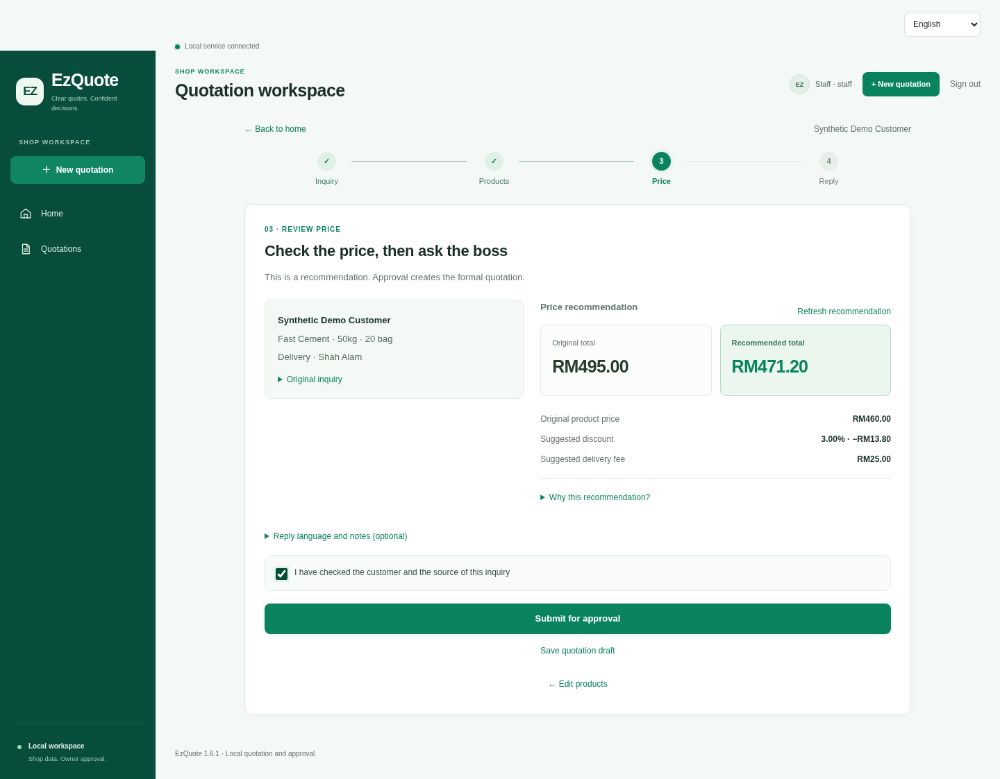
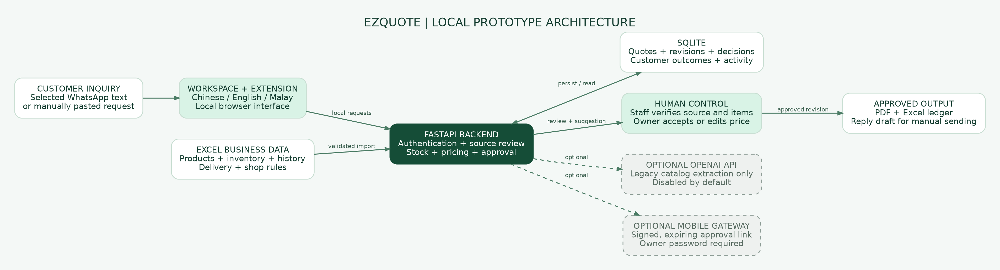
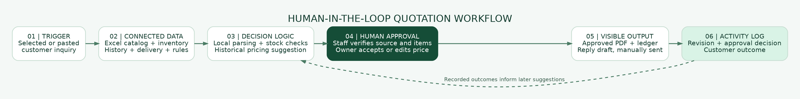

# EZQuote

EzQuote MVP 1.6.1 is a local quotation workspace and WhatsApp Web Chrome extension for building-materials stores. It supports Chinese, English and Malay throughout inquiry review, product matching, pricing, owner approval and customer replies.

The default workflow uses local rules and historical business statistics. No AI or WhatsApp API key is required. The owner controls the final price, and staff review customer replies before sending them.

## Problem and target users

EZQuote is designed for Malaysian building-materials and hardware micro and small enterprises that receive quotation requests through WhatsApp. A request may mix languages, omit specifications, or describe a use rather than a product code. Staff then need to consult product spreadsheets, check stock, calculate delivery and discounts, obtain the owner's approval, and prepare a consistent reply.

The prototype brings those steps into one reviewable workflow. It aims to reduce repeated data entry and make the basis of a quotation visible; no measured time-saving or business-growth claim is made.

## Solution overview

- Organize Chinese, English and Malay inquiries and ask for missing information.
- Match requirements to the shop's imported product catalog and stock snapshot.
- Calculate original prices from Excel data and suggest discounts and delivery fees using historical orders and store rules.
- Require staff review and owner approval, including recorded reasons for manual corrections.
- Generate the approved PDF quotation, Excel ledger and customer-language reply draft.
- Record customer outcomes so later suggestions can use the updated history.

## Live demo

**Awaiting verified public URL.** The current prototype has been validated locally. A Replit-hosted public demo and proof of use are not yet verified in this repository. Judges can run the full local workflow using the instructions below; the Chrome extension provides the WhatsApp entry on the same computer.

## Product demo video

A 51-second [local product demo recording (MP4)](submission/EzQuote_Demo.mp4) shows the real English interface: inquiry, product matching, staff submission, owner price edits, PDF download and customer-outcome recording. It uses isolated synthetic data with external APIs disabled.

**YouTube link pending.** The recording is ready to upload, but no final public or unlisted YouTube URL has been supplied. A real local-workflow screenshot is included below.



## Architecture



The plain HTML/CSS/JavaScript workspace and Manifest V3 Chrome extension call the local FastAPI backend. The backend reads the imported business workbook and stores accounts, quotation revisions, approvals and activity in SQLite. Pricing and approval checks run on the server; ReportLab and openpyxl produce the approved PDF and Excel outputs. An optional separate mobile gateway handles signed approval links.

## Human-in-the-loop workflow



**Trigger → Connected data → Decision logic → Human approval → Visible output → Activity log**

An explicitly selected inquiry or manually entered request triggers the workflow. Connected data comes from the shop's product, inventory, history, delivery and rule sheets. Local parsing, catalog matching, stock checks and historical pricing produce a suggestion. Staff verify the source and details; the owner accepts or edits the price within the rules. Approval produces downloadable files and a reply draft. Revisions, corrections, approvals and customer outcomes are recorded for traceability.

## AI and API disclosure

The complete business-data demonstration runs with local rules, catalog matching and historical statistics. Its pricing is calculated by the application, not generated by an LLM.

The code also includes an **optional OpenAI Responses API adapter for legacy catalog-mode extraction**, disabled by default. Its configured default model is `gpt-5.4-mini`; returned product and quantity data are validated against the catalog. The included validation does not claim a verified live model call. **Qwen integration is not implemented in this version.**

Optional WhatsApp mobile notifications use the Meta Cloud API; they are not required for the local demo. API acceptance is not delivery confirmation. Replit deployment and external team usage of Replit or RunPod require supporting evidence; no such usage is claimed from code presence alone. See [integrations](docs/INTEGRATIONS.md) and the [tools declaration](submission/Tech_Tools_Declaration.pdf) for details.

## SDG impact

These are intended contributions, not measured impact results:

| Target | Relevance to the prototype |
| --- | --- |
| SDG 8.2 — Productivity through technological upgrading and innovation | Combines inquiry review, spreadsheet data, calculations and approval in one workflow, with the aim of reducing repeated manual work. |
| SDG 8.3 — Productive activities, entrepreneurship and micro/small enterprise development | Gives small stores a structured quotation and record-keeping process using their existing business spreadsheets. |
| SDG 9.3 — Small-enterprise participation in value chains and markets | Consistent quotations and traceable commercial records may support customer and supplier interactions. The prototype does not provide financing or demonstrate improved access to credit. |

No environmental benefit, revenue increase or job-creation effect has been quantified.

## Submission materials

| Material | Link or status |
| --- | --- |
| Submission status and outstanding evidence | [Materials index](submission/README.md) |
| Technical tools declaration | [PDF](submission/Tech_Tools_Declaration.pdf) |
| Pitch deck | [PDF](submission/Pitch_Deck_EzQuote.pdf) · [Editable PowerPoint](submission/Pitch_Deck_EzQuote.pptx) |
| Official preliminary proposal | Awaiting the completed source document and required personal confirmations. |
| Replit proof of use | Awaiting genuine account, running-project and usage evidence. |
| Product demo recording | [MP4](submission/EzQuote_Demo.mp4); a YouTube URL is still required. |
| Public prototype | Awaiting a verified public URL. |
| RunPod proof | Include only if the team actually used RunPod and supplies evidence. |

Pending items are not represented as completed submissions.

## Run the application

Install Python 3.10+ (3.12 recommended), then run this command from the repository root:

```bash
python run.py
```

On macOS / Linux, use `python3 run.py` if `python` is unavailable. The launcher creates `.venv`, installs runtime dependencies and opens the workspace. Keep the terminal open; press `Ctrl+C` to stop. Windows users can also double-click `Start Windows.bat`; macOS / Linux users can run `Start Mac Linux.command`.

On first launch, create a shop and separate owner and staff passwords. The account names are `boss` and `staff`.

## Load the WhatsApp extension

1. Open `chrome://extensions` in Chrome and enable **Developer mode**.
2. Choose **Load unpacked** and select this project's `extension/` folder.
3. Keep the local backend running and refresh WhatsApp Web.
4. Select an inquiry or use its quotation entry, then sign in as `staff` in the side panel. Use a separate workspace tab for the `boss` account.

The backend and extension use local port 8765. Each computer runs its own backend and keeps its own data. The GitHub repository provides source code; the application runs on the computer where it is installed.

## Try the complete workflow

1. Sign in as `boss`, open **Settings → Business data**, and check and import `samples/business_demo.xlsx`.
2. As `staff`, start a new quotation and enter:

   > Hi boss, I need 20 bags cement for plastering. Prefer fast setting. Deliver to Shah Alam. How much?

3. Review the matched product, quantity and delivery area, confirm the source, and submit for owner approval.
4. With the fresh sample workbook, the original total is **RM495.00** and the suggested total is **RM471.20**. The owner can accept it or adjust the price within the business rules.
5. After approval, download the PDF and Excel files, choose a reply language, and check the chat draft before sending. Attach the PDF separately.
6. Record the customer's outcome to include it in later pricing suggestions.

See the [user guide](docs/USER_GUIDE.md) for the complete demonstration, manual corrections, backups and operating limits. The [business data format](docs/DATA_FORMAT.md) explains the workbook. Optional AI connections and mobile approvals are covered in [integrations](docs/INTEGRATIONS.md).

## Project layout

| Path | Contents |
| --- | --- |
| `extension/` | Chrome extension and workspace interface |
| `backend/` | APIs, parsing, pricing, approvals and exports |
| `mobile/` | Optional mobile approval interface |
| `assets/` | PDF font and its license |
| `samples/` | Synthetic demonstration workbooks and product data |
| `tests/` | Backend regressions, extension checks and browser tests |
| `docs/` | User guide, data format, integrations and testing instructions |
| `submission/` | Submission materials and evidence status |
| `tools/build_release.py` | Release ZIP packaging and integrity checks |

## Development

```bash
python -m venv .venv
# macOS / Linux
source .venv/bin/activate
python -m pip install -r requirements-dev.txt
python -m pytest tests -q
node tests/extension_checks.mjs
```

On Windows, activate with `.venv\Scripts\Activate.ps1` in PowerShell or `.venv\Scripts\activate.bat` in cmd. Node.js is used for development checks; ordinary application use does not require it. See [testing](docs/TESTING.md) for browser tests and release packaging, and [API.md](API.md) for endpoint contracts.

Runtime data is kept in the ignored `data/` directory by default. Stop the service before backing it up. Preserve `data/` and `.venv/` when updating an installation; do not share personal data or credentials in a submission package.

## Privacy and limitations

The supplied workbooks, test accounts and demonstration records are synthetic. The extension processes the inquiry the user actively selects; it does not upload chat histories in bulk. Real inquiries sent through an enabled external AI connection leave the local application, so review the provider's terms and the shop's data policy before enabling it.

Keep runtime databases, credentials, access tokens, browser sessions and real customer information outside Git. Optional connection credentials are stored in local settings under `data/`; that directory is excluded from the repository and release package.

Stock is an imported snapshot, without automatic reservations or stock movements. Complex or ambiguous inquiries need human clarification. Each installation keeps separate local data. The prototype does not execute payments, submit tax filings, or provide legal or financial advice. Native Chrome/WhatsApp integration and live external services still require checks with the corresponding real accounts and environment.

## License

Project code is licensed under the [Apache License 2.0](LICENSE). Bundled font assets retain their own notices: Noto Sans SC uses the [SIL Open Font License](assets/OFL.txt).
